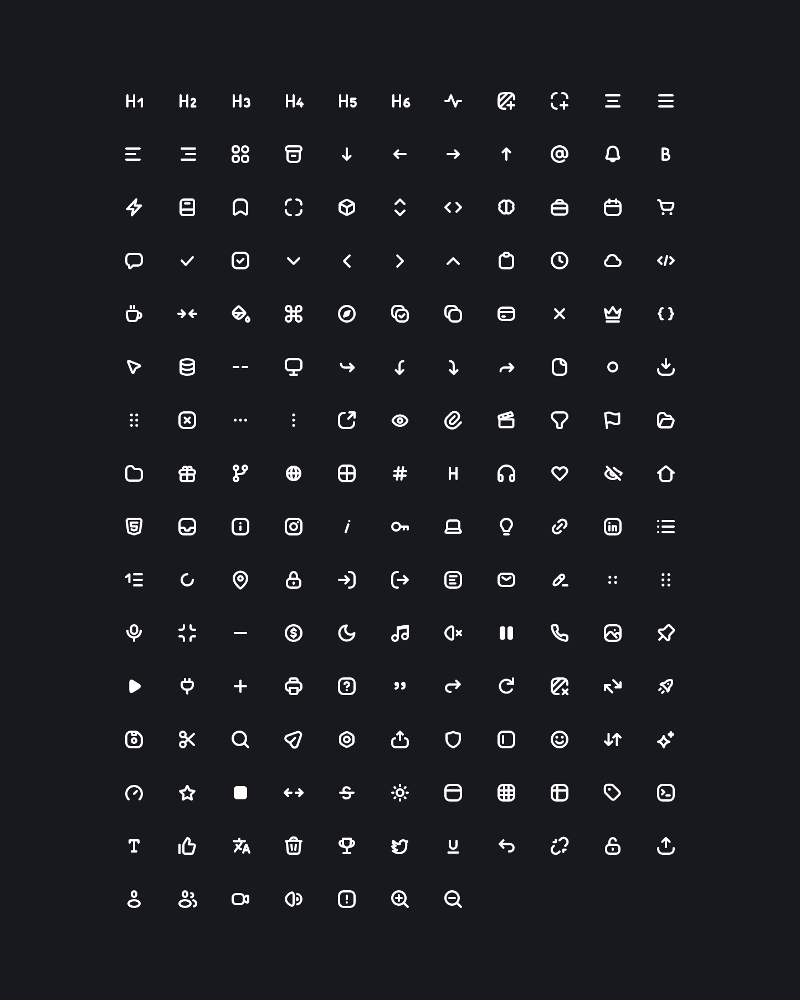

# CodeX Icons (extended)

[](https://www.npmjs.com/package/@davidabou/icons)
[](https://www.npmjs.com/package/@davidabou/icons)
[](LICENSE)

A growing set of small, airy outline icons, for Vue, React, Nuxt or plain JavaScript. It extends [CodeX Icons](https://github.com/codex-team/icons) with new icons drawn to be indistinguishable from the originals, and keeps every original `IconXxx` export, so it works as a drop-in replacement for `@codexteam/icons`.

**[Browse the icons on icons.abou.dev →](https://icons.abou.dev)**

[](https://icons.abou.dev)

## Features

- **Consistent style**: 24×24 grid, 14×14 live area, 2px rounded strokes, outline only.
- **Colors with your text**: every icon uses `currentColor`.
- **Tree-shakable**: only the icons you import end up in your bundle.
- **Real SVG elements** in the Vue, React and Nuxt components: no `v-html` or `dangerouslySetInnerHTML`, so they work with server-side rendering and strict CSP.
- **Typed**: TypeScript declarations, with autocompletion of the icon names.
- **ESM only**: works with every modern bundler, and with `require()` on Node.js 20.19 or later.

## Packages

All packages share the same version.

| Package | For | Version |
| --- | --- | --- |
| [`@davidabou/icons-vue`](packages/vue#readme) | Vue 3 components | [](https://www.npmjs.com/package/@davidabou/icons-vue) |
| [`@davidabou/icons-react`](packages/react#readme) | React 18/19 components | [](https://www.npmjs.com/package/@davidabou/icons-react) |
| [`@davidabou/nuxt-icons`](packages/nuxt#readme) | Nuxt 4 module, auto-imported `<CodeXIcon>` | [](https://www.npmjs.com/package/@davidabou/nuxt-icons) |
| [`@davidabou/icons`](#vanilla-javascript) | SVG strings, for any framework or none | [](https://www.npmjs.com/package/@davidabou/icons) |

## Usage

Each icon has two names, derived from its file name: `IconArrowLeft` for imports, and `arrow-left` for the Nuxt component, the dynamic `icons` map and the website URLs.

### Vue

```sh
bun add @davidabou/icons-vue
```

```vue
<script setup lang="ts">
import { IconHeart } from '@davidabou/icons-vue';
</script>

<template>
  <IconHeart :size="20" class="text-primary" />
</template>
```

### React

```sh
bun add @davidabou/icons-react
```

```tsx
import { IconHeart } from '@davidabou/icons-react';

<IconHeart size={20} className="text-primary" />
```

### Nuxt

```sh
bunx nuxi module add @davidabou/nuxt-icons
```

```vue
<CodeXIcon name="heart" :size="20" />
```

### Vanilla JavaScript

```sh
bun add @davidabou/icons
```

Each icon is exported as an SVG string:

```js
import { IconHeart } from '@davidabou/icons';

button.innerHTML = IconHeart; // '<svg xmlns="http://www.w3.org/2000/svg" ...'
```

Icons are 24px by default. Resize them with CSS and color them with `color`:

```css
.icon svg {
  width: 20px;
  height: 20px;
  color: tomato;
}
```

### SVG files

Optimized SVG files are available in [`dist/icons`](dist/icons), for design tools or direct use in an ``, for example through jsDelivr:

```html

```

Each icon can also be resized, recolored and downloaded on [icons.abou.dev](https://icons.abou.dev).

### For LLMs and coding assistants

Point your assistant to [icons.abou.dev/llms-full.txt](https://icons.abou.dev/llms-full.txt): it describes the packages and lists every icon with its exact names, so the generated code uses icons that exist.

## Migrating from `@codexteam/icons`

Every `IconXxx` export of `@codexteam/icons` exists here under the same name. Swap the package and the imports:

```sh
bun remove @codexteam/icons
bun add @davidabou/icons
```

```diff
- import { IconHeart } from '@codexteam/icons';
+ import { IconHeart } from '@davidabou/icons';
```

## Contributing

- **Missing an icon?** [Request it](https://github.com/davidabou/icons/issues/new?template=icon-request.yml).
- **Want to draw it?** Read [CONTRIBUTING.md](CONTRIBUTING.md): naming rules, style guide and checklist.

## License

[MIT](LICENSE). Original icons © 2022 CodeX, additions © 2026 davidabou.

This is an independent fork, not affiliated with or endorsed by CodeX.
