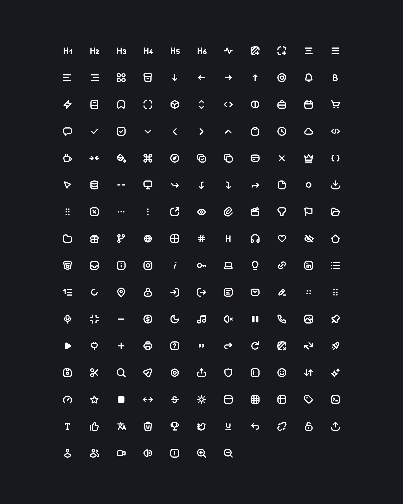

# CodeX Icons for Nuxt

[](https://www.npmjs.com/package/@davidabou/nuxt-icons)
[](https://www.npmjs.com/package/@davidabou/nuxt-icons)
[](https://nuxt.com)

The [`@davidabou/icons`](https://github.com/davidabou/icons) pack (an extended fork of CodeX Icons) as a Nuxt module.

[](https://icons.abou.dev)

## Features

- **Auto-imported `<CodeXIcon>`**: no imports, just the icon name.
- **Real SVG elements**, rendered on the server, no `v-html`.
- **Colors with your text**: every icon uses `currentColor`.
- **Typed names**, with autocompletion and type errors on unknown names.

Requires Nuxt 4. Built on [`@davidabou/icons-vue`](https://github.com/davidabou/icons/tree/master/packages/vue).

## Installation

```sh
bunx nuxi module add @davidabou/nuxt-icons
# or
npx nuxi module add @davidabou/nuxt-icons
```

It installs the package and adds it to the `modules` of your `nuxt.config.ts`. To do it by hand:

```sh
bun add @davidabou/nuxt-icons
```

```ts
export default defineNuxtConfig({
  modules: ['@davidabou/nuxt-icons']
})
```

## Usage

Use `<CodeXIcon>` (or `<code-x-icon>`) with the icon name in kebab-case, as shown on [icons.abou.dev](https://icons.abou.dev) (`arrow-left`, `table-with-headings`, `h1`…).

```vue
<template>
  <CodeXIcon name="heart" />
  <CodeXIcon name="sparkles" :size="20" class="text-primary" />
  <CodeXIcon :name="isOpen ? 'chevron-up' : 'chevron-down'" />
</template>
```

## Properties

| prop | type | description |
| -- | -- | -- |
| `name` | `CodeXIconName` | Required. Icon name in kebab-case, for example `arrow-left` |
| `size` | `number \| string` | Width and height, `24` by default (in pixels when a number) |

Any other attribute (`class`, `style`, `aria-label`, event listeners…) is passed to the `<svg>`.

Icons are decorative by default (`aria-hidden="true"`). Give them an `aria-label` when they carry meaning on their own, for example in an icon-only button.

## Typing your own props

The `CodeXIconName` type gives every icon name:

```vue
<script setup lang="ts">
import type { CodeXIconName } from '@davidabou/nuxt-icons';

defineProps<{ icon: CodeXIconName; label: string }>();
</script>

<template>
  <button><CodeXIcon :name="icon" /> {{ label }}</button>
</template>
```

`<CodeXIcon>` can render any icon, so it bundles all of them. To bundle only the icons you use, import them from [`@davidabou/icons-vue`](https://github.com/davidabou/icons/tree/master/packages/vue) instead.

## Migrating from `<DaIcon>`

`<DaIcon>` was replaced by `<CodeXIcon>` in 0.2.0, which takes kebab-case names without the `Icon` prefix:

```diff
- <DaIcon name="IconArrowLeft" />
+ <CodeXIcon name="arrow-left" />
```

The type of the names is now `CodeXIconName`. `<DaIcon>` and `DaIconName` still work, with the former names, but are deprecated.

In both components, the icon is no longer wrapped in a `<span class="da-icon">`: attributes now land on the `<svg>` itself, and the `.da-icon` class is gone.

## Development

```sh
bun install
bun run dev          # playground with hot reload
bun run test:types   # type-check the module and the playground
bun run prepack      # build the module into dist/
```

## Credits

Based on [`@codexteam/nuxt-icons`](https://github.com/codex-team/icons/tree/master/packages/nuxt) by [CodeX](https://codex.so), released under the MIT license. This fork is not affiliated with or endorsed by CodeX.

## License

MIT
