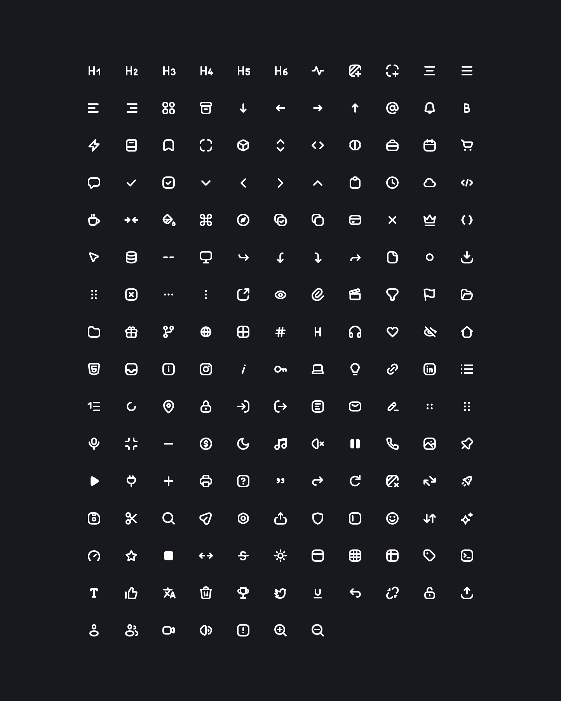

# CodeX Icons for React

[](https://www.npmjs.com/package/@davidabou/icons-react)
[](https://www.npmjs.com/package/@davidabou/icons-react)

The [`@davidabou/icons`](https://github.com/davidabou/icons) pack (an extended fork of CodeX Icons) as React components.

[](https://icons.abou.dev)

## Features

- **One component per icon**, tree-shakable: only the icons you import end up in your bundle.
- **Real SVG elements**, no `dangerouslySetInnerHTML`: works with server components, server-side rendering and strict CSP.
- **Colors with your text**: every icon uses `currentColor`.
- **Typed**, with autocompletion of the icon names.

Requires React 18 or later.

## Installation

```sh
bun add @davidabou/icons-react
# or
npm install @davidabou/icons-react
```

## Usage

Each icon is a component named after its file in `PascalCase` with an `Icon` prefix (`arrow-left.svg` → `IconArrowLeft`). Browse them on [icons.abou.dev](https://icons.abou.dev).

```tsx
import { IconHeart, IconSearch } from '@davidabou/icons-react';

export function Toolbar () {
  return (
    <>
      <IconHeart />
      <IconSearch size={20} className="text-primary" />
      <IconHeart aria-label="Like" />
    </>
  );
}
```

## Properties

| prop | type | description |
| -- | -- | -- |
| `size` | `number \| string` | Width and height, `24` by default (in pixels when a number) |

Any other SVG prop (`className`, `style`, `aria-label`, event handlers…) is passed to the `<svg>`, and `ref` gives the `SVGSVGElement`.

Icons are decorative by default (`aria-hidden="true"`). Give them an `aria-label` when they carry meaning on their own, for example in an icon-only button.

## Dynamic icons

When the icon is only known at runtime, the `icons` map gives every icon by its name in kebab-case, as shown on [icons.abou.dev](https://icons.abou.dev):

```tsx
import { icons, type IconName } from '@davidabou/icons-react';

export function Icon ({ name }: { name: IconName }) {
  const Component = icons[name];

  return <Component />;
}
```

Importing `icons` bundles every icon: prefer the named exports when the icon is known.

The `IconComponent` type can be used to type your own props:

```tsx
import type { IconComponent } from '@davidabou/icons-react';

function MenuItem ({ icon: Icon, label }: { icon: IconComponent; label: string }) {
  return <li><Icon size={20} /> {label}</li>;
}
```

## License

MIT
