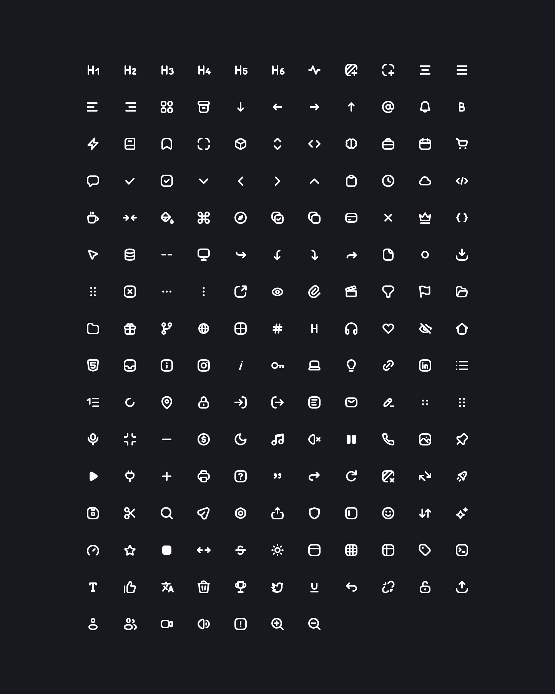

# CodeX Icons for Vue

[](https://www.npmjs.com/package/@davidabou/icons-vue)
[](https://www.npmjs.com/package/@davidabou/icons-vue)

The [`@davidabou/icons`](https://github.com/davidabou/icons) pack (an extended fork of CodeX Icons) as Vue 3 components.

[](https://icons.abou.dev)

## Features

- **One component per icon**, tree-shakable: only the icons you import end up in your bundle.
- **Real SVG elements**, no `v-html`: works with server-side rendering and strict CSP.
- **Colors with your text**: every icon uses `currentColor`.
- **Typed**, with autocompletion of the icon names.

Requires Vue 3.3 or later. For Nuxt, see the [Nuxt module](https://github.com/davidabou/icons/tree/master/packages/nuxt).

## Installation

```sh
bun add @davidabou/icons-vue
# or
npm install @davidabou/icons-vue
```

## Usage

Each icon is a component named after its file in `PascalCase` with an `Icon` prefix (`arrow-left.svg` → `IconArrowLeft`). Browse them on [icons.abou.dev](https://icons.abou.dev).

```vue
<script setup lang="ts">
import { IconHeart, IconSearch } from '@davidabou/icons-vue';
</script>

<template>
  <IconHeart />
  <IconSearch :size="20" class="text-primary" />
  <IconHeart aria-label="Like" />
</template>
```

## Properties

| prop | type | description |
| -- | -- | -- |
| `size` | `number \| string` | Width and height, `24` by default (in pixels when a number) |

Any other attribute (`class`, `style`, `aria-label`, event listeners…) is passed to the `<svg>`.

Icons are decorative by default (`aria-hidden="true"`). Give them an `aria-label` when they carry meaning on their own, for example in an icon-only button.

The `IconComponent` type can be used to type your own props:

```ts
import type { IconComponent } from '@davidabou/icons-vue';

defineProps<{ icon: IconComponent }>();
```

## License

MIT
